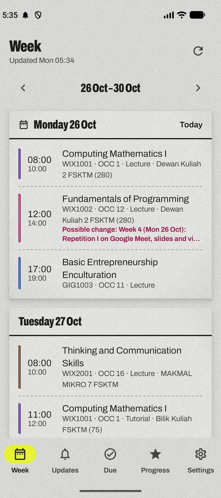
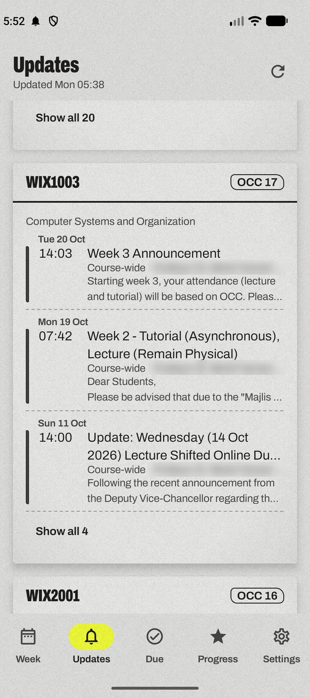
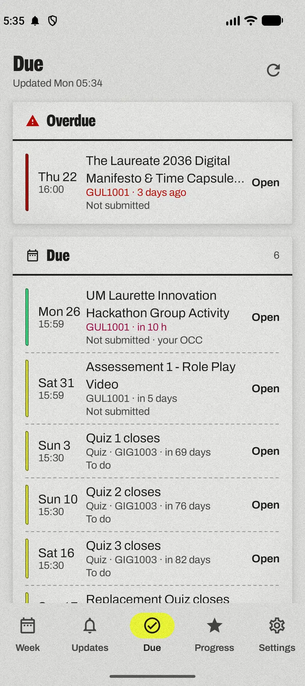
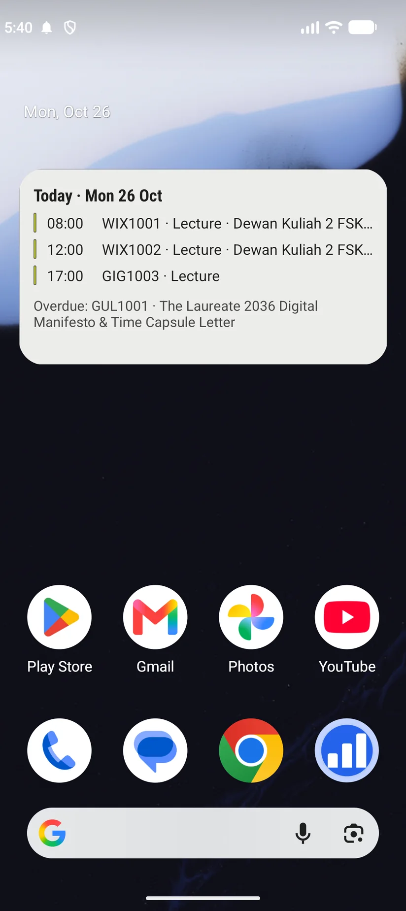

# Spectrum+

**An unofficial Android companion for Spectrum, Universiti Malaya's Moodle.** 
It shows only your own occurrence (OCC) for each course: your classes, your posts, your deadlines.

[Website](https://entropicsoftwarelabs.com/spectrum/) · [All releases](https://github.com/josephting1105123/Spectrum-Plus/releases)

 

<picture>
  <source media="(prefers-color-scheme: dark)" srcset=".github/assets/spectrum-week-dark.webp">
  
</picture>&nbsp;
<picture>
  <source media="(prefers-color-scheme: dark)" srcset=".github/assets/spectrum-updates-dark.webp">
  
</picture>&nbsp;
<picture>
  <source media="(prefers-color-scheme: dark)" srcset=".github/assets/spectrum-due-dark.webp">
  
</picture>&nbsp;
<picture>
  <source media="(prefers-color-scheme: dark)" srcset=".github/assets/spectrum-home-dark.webp">
  
</picture>

Spectrum+ filters each course down to your OCC and checks for changes in the background, so you see only the classes, posts and deadlines that apply to you.

## Features

- **Week**: your timetable, with a badge on any class that moved, went online or was cancelled
- **Updates**: announcements and new materials for your OCC, newest first, searchable
- **Due**: assignments by deadline with submission status, plus reminders 24 h and 3 h before
- **Courses**: every course, with *Open in Spectrum* on each item
- **MAYA import**: pulls in your timetable and OCCs
- **Widget**: today's classes and the next deadline on your home screen

## Install

1. Download `Spectrum.apk` on your Android phone.
2. Open it. If Android asks, allow your browser or file manager to install unknown apps.
3. Open Spectrum+ and sign in with your siswa365 Microsoft account.

To update, download the new APK and install it over the old one. Your data stays.

## Privacy

Sign-in goes through UM's own Microsoft 365 page, so the app never sees your password. It keeps only the Spectrum session token, encrypted on your phone. Your data stays on the phone, and the app talks to Spectrum and nothing else.

## Disclaimer

Spectrum+ is an independent student project. It is not affiliated with or endorsed by Universiti Malaya.
